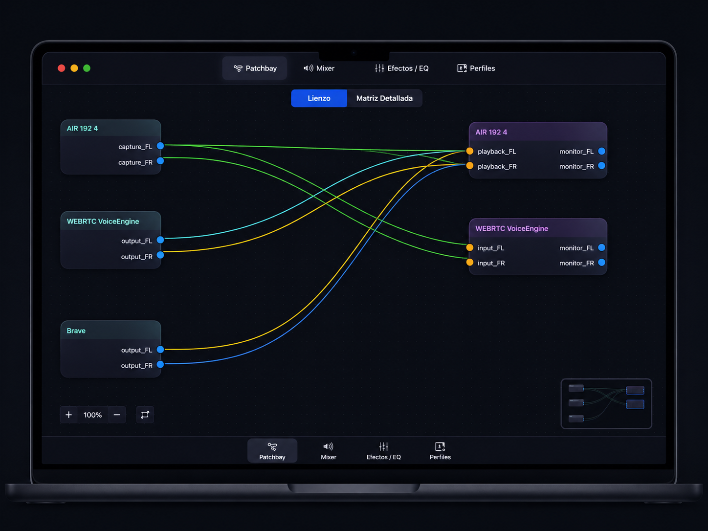

# Audibian



**Audibian** is an open-source desktop audio management application for Linux, built with **Rust and Tauri 2** (WebKitGTK shell, React frontend).  
It provides a routing matrix, a full mixer with sends and returns, per-strip EQ, noise suppression, a soundboard, MIDI plugin hosting and persistent audio profiles — all on top of **PipeWire**.

Tested on **Debian 13 (Trixie)** with PipeWire ≥ 1.2.

---

## Features

| Feature | Details |
|---|---|
| 🔀 **Routing Matrix** | Grid view of the PipeWire graph. Toggle a cell to create or destroy a link between any output and input port. |
| 🎚️ **Mixer** | Input strips, return buses and a master bus, each with fader, pan, mute, solo and stereo level meters. Sends route any input to any return. |
| 🎛️ **Per-strip EQ** | Parametric EQ applied per strip through a PipeWire filter-chain virtual sink. |
| 🎙️ **Noise Suppression** | Per-microphone WebRTC noise suppression. Creates a virtual clean source (`audibian-ns-…`) that any app can select instead of the raw mic. |
| 🔊 **Soundboard** | Trigger sound files into a dedicated `audibian_soundboard` strip, with optional start/end trimming via ffmpeg. |
| 🎹 **MIDI** | MIDI channel management with native, in-process VST3 plugin hosting (no external Carla dependency); each MIDI channel gets its own mixer strip with fader, pan, mute and solo; plugin GUIs are reparented into the main window on X11. |
| 💾 **Audio Profiles** | Save and restore complete audio states as TOML files under `~/.config/audibian/profiles/`. |
| ⚡ **Persistent Routing** | `audibian --apply-persistent` recreates the whole graph headlessly. Ship it as a systemd user unit and your routing is live from login, with or without the GUI. |
| 🚀 **Autostart** | One toggle creates an XDG autostart entry (`~/.config/autostart/audibian.desktop`) so Audibian launches with your desktop session. |

---

## Requirements

### Runtime

| Dependency | Minimum version | Debian package |
|---|---|---|
| PipeWire | 1.2 | `pipewire` |
| PipeWire PulseAudio layer | — | `pipewire-pulse` (`pactl` is used for module management) |
| WebKitGTK 4.1 | — | `libwebkit2gtk-4.1-0` |
| GTK 3 | — | `libgtk-3-0` |
| ffmpeg | — | `ffmpeg` (only for trimmed soundboard clips) |

> **Noise suppression** uses `libpipewire-module-echo-cancel` with the WebRTC backend (`libspa-aec-webrtc`), which ships with PipeWire on Debian — no extra packages needed.

### Build

| Dependency | Minimum version | Debian package |
|---|---|---|
| Rust + Cargo | 1.77 | [rustup.rs](https://rustup.rs) |
| Node + pnpm | Node 20 | `nodejs`, then `npm i -g pnpm` |
| WebKitGTK dev headers | 4.1 | `libwebkit2gtk-4.1-dev` |
| GTK 3 dev headers | — | `libgtk-3-dev` |
| PipeWire dev headers | 1.2 | `libpipewire-0.3-dev`, `libspa-0.2-dev` |
| ALSA dev headers (MIDI I/O) | — | `libasound2-dev` |
| libclang (for bindgen) | — | `clang`, `libclang-dev` |
| AppIndicator dev headers | — | `libayatana-appindicator3-dev` |
| librsvg | — | `librsvg2-dev`, `librsvg2-bin` (icon generation) |
| pkg-config | — | `pkg-config` |

Install all build dependencies on Debian:

```bash
sudo apt install \
  build-essential pkg-config libssl-dev \
  libwebkit2gtk-4.1-dev libgtk-3-dev libayatana-appindicator3-dev \
  librsvg2-dev librsvg2-bin \
  libpipewire-0.3-dev libspa-0.2-dev libasound2-dev \
  clang libclang-dev \
  nodejs npm && npm install -g pnpm
```

> The `pipewire` crate is built with the `v1_2_0` feature, so PipeWire headers
> **1.2 or newer** are mandatory. Debian 12 (Bookworm) ships 0.3 and will not
> build; use Debian 13 (Trixie) or newer.

---

## Installation

### Pre-built AppImage

Grab `Audibian-x86_64.AppImage` from the [latest release](https://github.com/Markox36/audibian/releases), make it executable and run it:

```bash
chmod +x Audibian-x86_64.AppImage
./Audibian-x86_64.AppImage
```

On systems without FUSE 2 (`sudo apt install libfuse2` fixes it permanently):

```bash
APPIMAGE_EXTRACT_AND_RUN=1 ./Audibian-x86_64.AppImage
```

### Build from source

```bash
git clone https://github.com/Markox36/audibian.git
cd audibian
make release
```

`make release` builds the React frontend with pnpm and then compiles the
binary with the `custom-protocol` feature, which is required outside
`cargo tauri dev` — without it Tauri loads the vite dev server and you get a
blank window. The binary lands at `target/release/audibian`.

### Install system-wide

```bash
sudo make install            # binary, desktop entry and icons under /usr/local
make install-autostart       # optional: launch with the desktop session
make install-systemd         # optional: rebuild the routing graph at login
```

`make install-systemd` installs a user unit that runs
`audibian --apply-persistent`, which recreates the virtual sinks, returns,
master bus and EQs headlessly. Enable it with:

```bash
systemctl --user enable --now audibian-apply.service
```

### Packaging

```bash
make appimage   # Audibian-x86_64.AppImage (downloads linuxdeploy on demand)
make deb        # requires cargo-deb
make rpm        # requires cargo-generate-rpm
make arch       # PKGBUILD under packaging/arch
```

---

## Usage

The window is organised in tabs: **Matrix · Mixer · Soundboard · MIDI · Effects · Profiles · ⚙**.

### Matrix

A grid of every output port (rows) against every input port (columns). Click a
cell to create the link, click again to destroy it.

### Mixer

Input strips, return buses and the master bus. Each strip has a fader, pan,
mute, solo and a stereo level meter. Sends route any input to any return, and
each input can be toggled in or out of the master bus.

Strips are backed by real PipeWire null-sinks named `audibian_<name>`, so any
application can select them as its output device.

### Soundboard

Add sound files to the library and trigger them into the `audibian_soundboard`
strip. Clips can be trimmed with start/end markers, in which case playback goes
through an ffmpeg pipe.

### MIDI

Manage MIDI channels and host plugins. On X11 the plugin GUI is reparented into
the Audibian window instead of floating separately.

### Effects

1. Select a **sink** from the drop-down.
2. Adjust the 5-band EQ (Low Shelf · Peak × 3 · High Shelf).
3. Apply — a virtual sink `audibian-eq-<name>` appears; route your apps to it.

Noise suppression lives in the same tab: toggle the switch next to any
microphone and a virtual source `audibian-ns-<name>` appears. Select it in
Discord, OBS or similar instead of the raw microphone.

### Profiles

Save the current routing and mixer state as a named profile, reload it later,
or mark one as default so it is applied at startup once PipeWire has enumerated
every node.

### Settings

The ⚙ tab holds UI scaling, the low-latency PipeWire drop-in toggle and the
autostart switch, which writes `~/.config/autostart/audibian.desktop`.

---

## Configuration files

| Path | Purpose |
|---|---|
| `~/.config/audibian/config.toml` | App settings (default profile, autostart, low latency) |
| `~/.config/audibian/mixer.toml` | Mixer layout: inputs, returns, sends, master |
| `~/.config/audibian/matrix.toml` | Routing matrix state |
| `~/.config/audibian/soundboard.toml` | Soundboard library |
| `~/.config/audibian/midi/` | MIDI channel and plugin configuration |
| `~/.config/audibian/profiles/*.toml` | Saved audio profiles |
| `/tmp/audibian-eq-*.conf` | Ephemeral EQ filter-chain configs (cleaned up on start) |
| `/tmp/audibian-ns-*.conf` | Ephemeral NS filter-chain configs (cleaned up on start) |
| `~/.config/autostart/audibian.desktop` | XDG autostart entry (created by the app) |
| `~/.config/systemd/user/audibian-apply.service` | Optional unit that rebuilds the graph at login |

---

## Architecture

```
src/
├── main.rs                  # Entry point, Tauri setup, PW event pump
├── commands.rs              # #[tauri::command] surface exposed to the frontend
├── state.rs                 # AppState shared with every command
├── proc.rs                  # Detached subprocess spawning (reaps its children)
├── persistent.rs            # Headless graph restoration (--apply-persistent)
├── meter.rs                 # Stereo RMS level sampling per strip
├── matrix_config.rs         # Routing matrix persistence
├── soundboard.rs            # Sound library + playback
├── x11_embed.rs             # Reparent MIDI plugin GUIs into the main window
├── audio/
│   ├── graph.rs             # Audio graph model (nodes, ports, links)
│   ├── pw_thread.rs         # PipeWire registry listener thread
│   ├── eq.rs                # Biquad EQ math (Audio EQ Cookbook)
│   ├── strip_eq.rs          # Per-strip EQ filter-chain instances
│   └── effects.rs           # EQ & noise suppression subprocess management
├── midi/
│   ├── host.rs               # In-process VST3 plugin hosting (vst3-host)
│   ├── stream.rs             # PipeWire audio-out stream driving the plugin process callback
│   └── input.rs              # MIDI input routing into hosted plugins
├── mixer/
│   ├── config.rs            # Inputs, returns, sends, master
│   └── snapshot.rs          # Fader/mute/pan snapshot serialisation
└── profiles/
    ├── model.rs             # AudioProfile serde model
    ├── store.rs             # TOML read/write under ~/.config/audibian/profiles/
    ├── apply.rs             # Profile apply & snapshot logic
    └── config.rs            # App settings (default profile, autostart)

ui/                          # React frontend (vite + Tailwind)
└── src/components/          # Matrix, Mixer, Soundboard, MidiChannels,
                             # Effects, Profiles, Settings
```

**Event flow:** PipeWire registry events arrive on a background thread
(`audio/pw_thread.rs`) and are forwarded over an `async_channel` to the Tauri
main thread, which mutates the `AudioGraph` behind an `Arc<Mutex<…>>` and emits
events to the React frontend. The frontend never talks to PipeWire directly; it
calls `#[tauri::command]` functions.

**Graph mutation** happens through `pw-link`, `pactl` and `pw-cli`
subprocesses rather than the PipeWire API. Those are launched via
`proc::CommandExt::spawn_detached`, which parks each child in a registry and
reaps it on the next call — `std::process::Child` does not reap on drop, so a
plain `let _ = Command::spawn()` would leak a zombie per routing change.

---

## Contributing

Contributions are welcome! Please open an issue before starting large features.

1. Fork the repository
2. Create a feature branch (`git checkout -b feat/my-feature`)
3. Commit your changes
4. Open a Pull Request

Every push and pull request runs the CI workflow (build, clippy and tests in a
Debian trixie container). Pushing a `v*` tag additionally builds the AppImage
and publishes it as a GitHub Release.

### Working on the UI

```bash
cd ui && pnpm dev:mock     # http://127.0.0.1:5199/?tab=mixer
```

This serves the frontend in a plain browser with `@tauri-apps/api` swapped for
the fixtures in `ui/src/dev/`, so the mixer renders with a realistic set of
channels and animated meters. Resize the window freely to check the responsive
bounds.

Prefer it to `cargo tauri dev` while an Audibian instance is already running:
a second real instance competes for the PipeWire graph and leaves duplicate
`pactl` modules behind. The mock never touches PipeWire.

`?tab=<id>` opens a specific tab — handy for screenshots.

### Code style

- Run `cargo clippy` before submitting.
- No panics in production paths — use `Option`/`Result` and log errors.
- Never `let _ = Command::spawn()`. Use `proc::CommandExt::spawn_detached` for
  fire-and-forget subprocesses, or keep the `Child` and reap it yourself —
  dropping it leaks a zombie.

---

## Changelog

### v0.2.0

- **Native VST3 hosting**: MIDI plugins now run in-process via the `vst3-host`
  crate instead of being driven through an external Carla subprocess over OSC.
  Removes the Carla runtime dependency and the `rosc` crate.
- MIDI channels are now full mixer strips (fader, pan, mute, solo, level
  metering) alongside inputs and returns, with per-channel plugin GUI controls
  in the mixer footer.
- Plugin GUI windows are shown/hidden directly through the new host handle.
- App-wide UI pass reusing the mixer's visual language across Matrix,
  Soundboard, Effects, Profiles and Settings.

### v0.1.0

- Initial public release: routing matrix, mixer with sends/returns, per-strip
  EQ, noise suppression, soundboard, MIDI/Carla plugin hosting, audio
  profiles, persistent routing and autostart.

---

## License

This project is licensed under the **GNU General Public License v3.0**.  
See [LICENSE](LICENSE) for details.

---

## Acknowledgements

- [Helvum](https://gitlab.freedesktop.org/pipewire/helvum) — inspiration for the routing matrix concept.
- [PipeWire](https://pipewire.org/) — the audio/video server powering this app.
- [pipewire-rs](https://gitlab.freedesktop.org/pipewire/pipewire-rs) — Rust bindings for PipeWire.
- [Tauri](https://tauri.app/) — the desktop shell.
- [linuxdeploy](https://github.com/linuxdeploy/linuxdeploy) — AppImage packaging.
